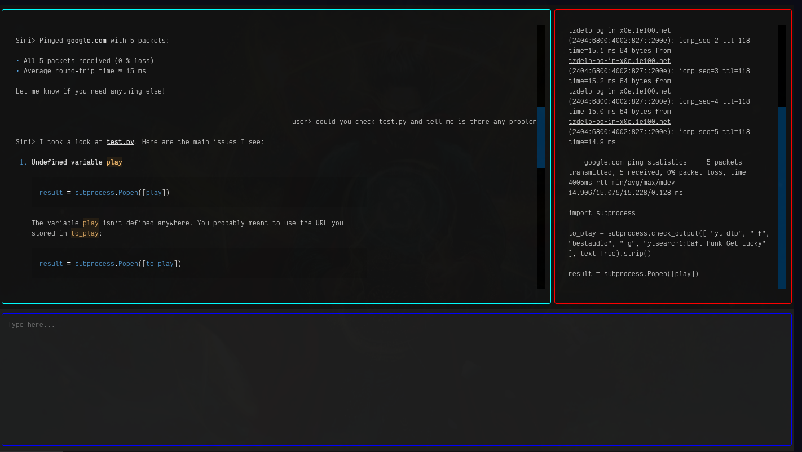
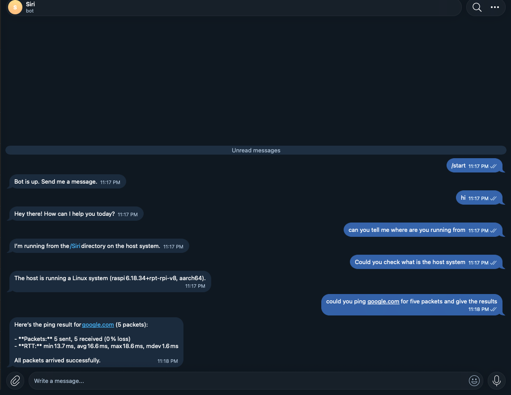
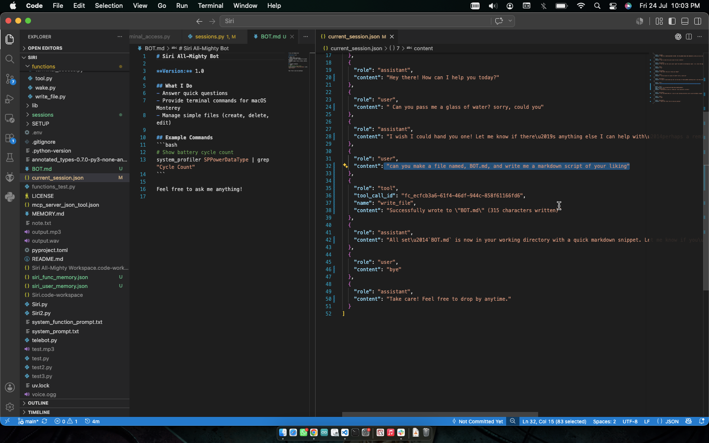
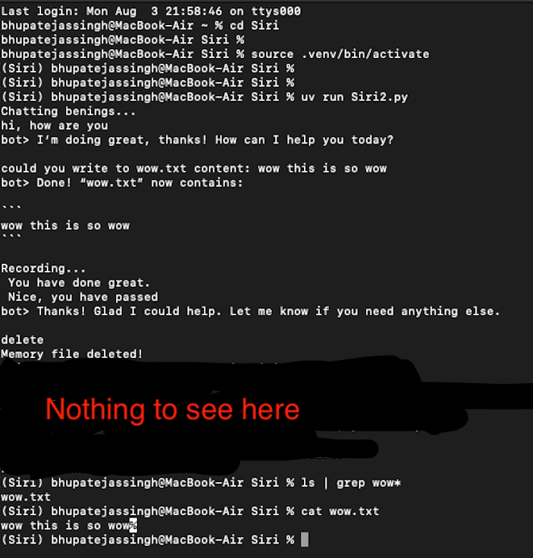

# Siri All-Mighty
A personal DIY assistant for all your needs, powered by **Groq** and **ElevenLabs**.

## The project has two parts:
### With TUI:
**siriApp.py**:
- **Voice command** — This doesn't fully support voice input, and you may encounter errors.
- **Normal input** — This includes multiline pormpts.

**Telegram bot** (telebot.py):
- A tool-calling agent you can text or voice-message from your phone using **Telegram**.

Without TUI:
- This is the older version of Siri All-Mighty which doesn't include any UI, just simple terminal.
- The version of the build is 0.1.1, you can find the source code, or the zip file in releases.
- Voice assistant (Siri2.py) — the original, mic + keyboard input, spoken replies, also includes multiline prompts.

## What it does
- Siri can accept text with multiline prompts, it also has the ability to respond in **Markdown**. Siri uses **Groq's** `gpt-oss-120b` model to generate responses and reason while **ElevenLabs** is used for generating voice output which is still in development.
- Or you could use it from **Telegram** which also accepts mutliline prompts and voice input, but voice output won't be available.
- Siri can also play songs, if you would like. You can pause/play at your will.
- Siri uses `whisper` for STT.

## How it works
- Siri works by using APIs provided by Groq and ElevenLabs. Groq is the *brain* of Siri and decides what todo with the prompt and uses the right tools when necessary.
- Tools are Separate `functions` in the functions folder, sometimes multiple functions in one folder ue to their similarity, which are all python programs. Siri comes with predefined functions, you can choose to edit those if you clone this repo.
- `functions` folder also comes with MCP tools which can be used by other Appa like **ChatGPT** or **Claude**
- Functions in the folder are not limited to tools and also contain helper functions like STT among other things.
- There is a separate function for executing the tool-calls from **Groq**.
- STT is done by the `STT.py` function which uses `sounddevice` to get input stream and `webrtcvad` for speech recognition.
- For TUI, Siri uses `textual`, which gives Siri markdown support.

## Requirements
- `yt-dlp` for downloading songs temporarily.
- `mpv` for playing songs.
- This project has only been tested on Arch Linux.
- **Groq** + **ElevenLabs** API keys (**Telegram** bot only needs **Groq**).
- **Telegram** bot token + your chat ID, for the Telegram bot, use **BotFather**.

# SETUP
```
git clone https://github.com/BTG9161/SIri-All-Mighty.git
cd SIri-All-Mighty
uv sync
./install.sh
```
`./install` makes you a global script for restoring sessions, for older build. If you don't have `uv`, copy the dependencies from `pyproject.toml` into a `requirements.txt`, and then- `pip install -r requirements.txt instead`.

Create a `.env`:
```
GROQ_API_KEY=your_key_here
ELEVENLABS_API_KEY=your_key_here
TELEGRAM_API_KEY=your_telegram_bot_token
PASS=secret_password
CHAT_IDS=comma,separated,allowed,chat,ids
DIR=path/to/your/sandbox
```
- It is recommended that you set up your DIR as a sandbox, you could choose not to. Or set these as environment variables directly in your shell instead of using `.env`.
- `PASS` is the password for Ttelegram* approving IDs authentication.

## Usage
### TUI:
```
uv siriApp.py
```
### Telegram Bot:
```
uv telebot.py
```
- Only chat IDs listed in `CHAT_IDS`, in `.env`(or enviornment vars), are allowed to talk to the bot.
- Or you can download the binaries(Siri2-macOS.zip and telebot-macOS.zip), and unzip them before executing.
- Don’t forget to make it executable `chmod +x siriApp`.

## Notes:
- `Siri.py` is not the main file — kept because...why not!?, no real use.
- You may change Siri.py for your system, because i won't.
- `SETUP/` holds a helper script for finding your Telegram chat ID.
- Don't use it if you don't trust it, it has terminl access. Or you can remove it by running `rm functions/terminal_access.py` along with editing
`mcp_tools_creation.py` and `execute_tool_call.py`.

## Agent in Action




## Prev Build
- The previous build includes voice output which is not present in this build in the releases page, but the prev build doesn't hae a UI.
